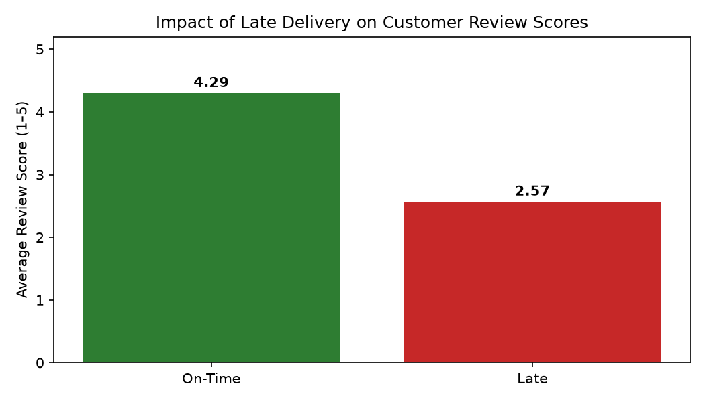
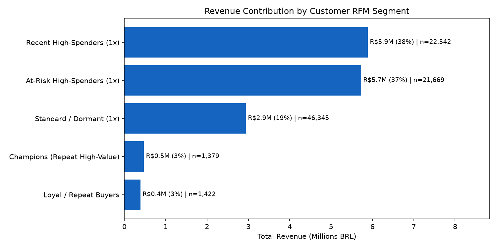
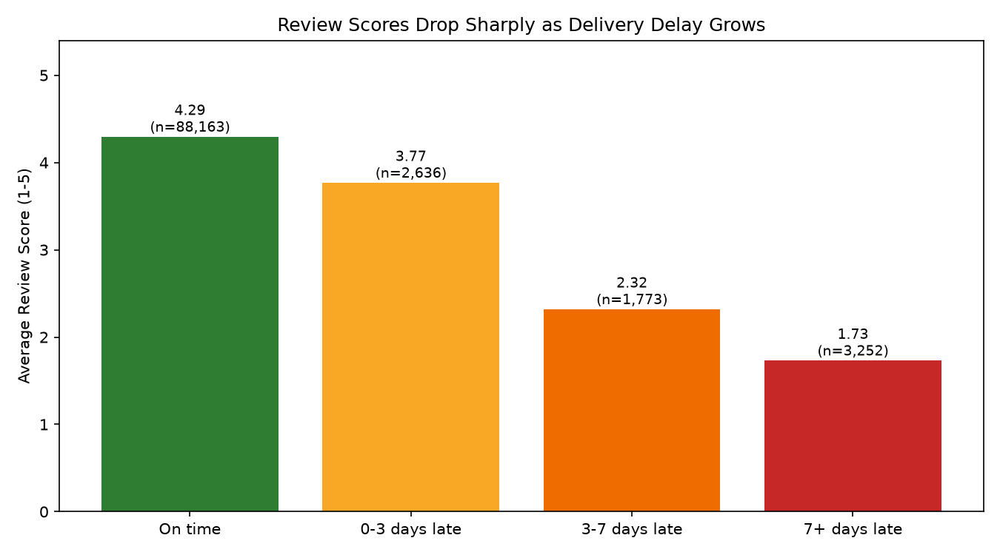

# E-Commerce Customer & Delivery Performance Analysis (Olist)

End-to-end SQL and Python analysis of about 100,000 Brazilian e-commerce orders from the Olist public dataset (CC BY-NC-SA 4.0). It covers customer value segments, seller quality risks, and the relationship between late deliveries and customer review scores.

## The Business Problem
A marketplace wants to know who its customers are, whether they come back, and whether late deliveries hurt customer satisfaction. This project answers those questions and turns them into actions.

## Key Findings & Recommendations
- **Late delivery penalty:** Orders delivered after their estimated date averaged **2.57** review stars vs. **4.29** for on-time orders, a **1.73-point** drop (95% CI 1.69 to 1.77; Welch's t-test, p < 0.001; Cohen's d about 1.2). The penalty grows with delay: orders 3 to 7 days late average about 2.3 stars, and 7+ days late average about 1.7. *Recommendation:* Notify customers and escalate with carriers before an order passes about 3 days late, where reviews drop sharply.
- **One-time buyers:** **96.88%** of unique customers purchased only once, generating about **R$15.06M** in payment value (**94.1%** of the R$16.01M total). *Recommendation:* Target recent one-time buyers with a post-delivery second-purchase incentive, starting with high spenders.
- **Seller quality risk:** **23** of **429** sellers with 50+ orders average below 3.5 stars, accounting for about **3.7%** of item revenue. *Recommendation:* Review these sellers first, starting with the lowest rated. Quality problems are concentrated in a small share of revenue, so intervention would cost little in sales.

## Data
- **Source:** [Olist Brazilian E-Commerce dataset on Kaggle](https://www.kaggle.com/datasets/olistbr/brazilian-ecommerce), 2016 to 2018
- **Scale:** 99,441 orders, 96,096 unique customers, 96,478 delivered orders
- **Late deliveries:** 7,826 (8.11% of delivered orders)
- **Currency:** Brazilian real (R$); payment value includes freight

## Methodology & Data Integrity
- **Preventing join fan-out:** Payments and order items were pre-aggregated at the `order_id` level in SQLite CTEs before joining to orders and reviews, preventing revenue double-counting.
- **Customer grain:** Customer analysis uses `customer_unique_id` because one person can have several `customer_id` values.
- **Late definition:** `order_delivered_customer_date > order_estimated_delivery_date`, evaluated on delivered orders with valid timestamps.
- **Reviews:** Aggregated to one row per order before joining, because some orders have multiple reviews.
- **Limitations:** Data covers 2016 to 2018, has no cost or margin data, and shows association, not causation. Late orders may also differ in size, distance, or seller.

## Visuals





## Skills Demonstrated
- **SQL:** JOINs, CTEs, GROUP BY, HAVING, date calculations, window functions
- **Python:** pandas, NumPy, SciPy
- **Statistics:** hypothesis testing, confidence intervals, effect sizes
- **Data quality:** grain validation, duplicate checks, fan-out prevention
- **Reporting:** automated Excel output and a reproducible pipeline

## How to Reproduce
1. Download the dataset from Kaggle into `data/raw/`.
2. Install dependencies:
   ```bash
   pip install pandas openpyxl matplotlib scipy
   ```
3. Run the pipeline:
   ```bash
   python src/run_report.py
   ```
4. Find results in `outputs/`.

## Project Structure
```text
olist-customer-delivery-analysis/
├── data/raw/        # Download dataset here (not committed)
├── outputs/         # Generated reports and charts
├── sql/             # SQL analysis queries
├── src/run_report.py
├── .gitignore
└── README.md
```
